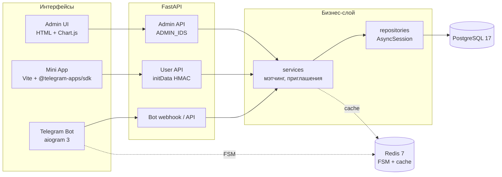

# Архитектура Connect

## Компоненты

## Поток запроса

1. Интерфейс (bot/miniapp/admin_ui) вызывает API.
2. Роутер валидирует входные данные (Pydantic v2) и вызывает `service`.
3. Service — чистая бизнес-логика, вызывает `repository`.
4. Repository — единственное место с SQLAlchemy-запросами.
5. Ответ — через Pydantic-схему; ошибки — единым форматом через exception-хендлеры.

## Слои и правила

## Слои и правила

| Слой | Где лежит | Можно | Нельзя |
|---|---|---|---|
| Интерфейсы | `src/connect/bot/`, `src/connect/api/routers/`, `miniapp/`, `admin_ui/` | валидация, вызов сервиса | SQL, бизнес-логика |
| Services | `src/connect/services/` | бизнес-логика, вызов repo, read-through кэш (Redis) | SQL-запросы напрямую |
| Repositories | `src/connect/repositories/` | SQLAlchemy-запросы | бизнес-решения, кэш и решения об отдаче из памяти |
| Модели | `src/connect/models/` | описание таблиц | логика |

## Ключевые инварианты

- Бизнес-логики в роутерах и хендлерах нет.
- SQL — только в `repositories/`.
- Datetime — только timezone-aware, храним в UTC.
- Секреты — только в `.env` через `pydantic-settings`.
- Весь Python — async, type hints везде, `ruff` чистый.
- Service владеет транзакцией: коммит в конце юз-кейса, rollback при ошибке; repository не коммитит никогда.
- Транзакцией владеет сервис; repositories не коммитят.
- Services поднимают доменные исключения из services/exceptions.py; интерфейсы маппят их в HTTP-коды и ответы бота едиными хендлерами.
- FSM хранит только шаги UI-визардов и черновики; бизнес-факты — только в PostgreSQL.
- Изменение схемы — только миграцией Alembic + правка database_design.md в том же PR приложение работает на async-движке, Alembic — на sync-движке того же драйвера psycopg v3
- initData: проверка HMAC и свежести auth_date (не старше 24 ч). Admin API отвечает только
при tg_id ∈ ADMIN_IDS.
- Бот: dev — polling, prod — webhook, переключается флагом в конфиге.
- miniapp/ и admin_ui/ лежат вне python-пакета; статику отдаёт FastAPI.
- Services вправе отправлять TG-уведомления через инъектированный экземпляр бота — единственное разрешённое пересечение сервисов с интерфейсами.
