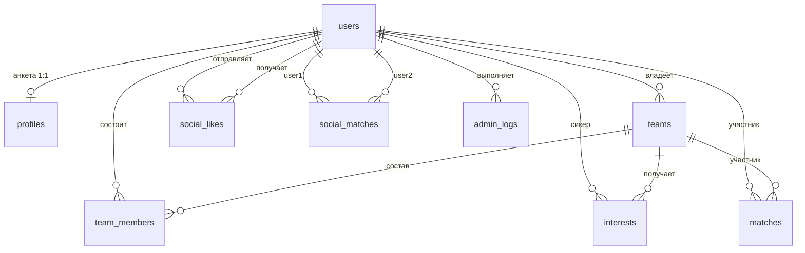

# Проектирование базы данных (PostgreSQL)

Статус: согласовано командой. Любое изменение схемы = миграция Alembic + правка этого файла в том же PR.

## 1. Продуктовый контекст

Один бэкенд (FastAPI) + одна PostgreSQL, модульный монолит. Режимы продукта:

- **Seeker** — ищет команду: анкета (profile) + отклики на команды.
- **Recruiter** — набирает команду: объявления (teams) + приглашения.
- **Social** — подбор по интересам: лайки между пользователями.
- **Admin** — модерация и журнал действий.

Взаимный интерес (в любом режиме) → **match** → открываются контакты → для командного режима доступна кнопка «вступить».

## 2. Конвенции именования и типов

- Таблицы: snake_case, множественное число (`users`, `team_members`, `admin_logs`).
- Колонки: snake_case; внешний ключ — `<сущность>_id` (`user_id`, `team_id`).
- Первичный ключ: `id BIGINT GENERATED BY DEFAULT AS IDENTITY`.
- Время: только `TIMESTAMPTZ`.
- Перечисления: `VARCHAR(n)` + `CHECK` (не PG ENUM: добавление значения не требует пересоздания типа).
- Индекс на каждую FK-колонку.
- Целостность данных (FK, UNIQUE, NOT NULL, CHECK) — в БД; бизнес-правила с подсчётами и внешними условиями — в сервис-слое.

## 3. ER-диаграмма

## 4. Схема таблиц

### users
| Колонка | Тип | Ограничения | Примечание |
|---|---|---|---|
| id | BIGINT | PK | |
| tg_id | BIGINT | NOT NULL, UNIQUE | ID Telegram |
| username | VARCHAR(64) | NULL | |
| role | VARCHAR(20) | NOT NULL, DEFAULT 'user', CHECK IN ('user','moderator','admin') | только для админки; seeker/recruiter — не роль, а режим использования |
| is_banned | BOOLEAN | NOT NULL, DEFAULT FALSE | |
| created_at | TIMESTAMPTZ | NOT NULL, DEFAULT now() | |

### profiles
| Колонка | Тип | Ограничения | Примечание |
|---|---|---|---|
| id | BIGINT | PK | |
| user_id | BIGINT | NOT NULL, UNIQUE, FK users ON DELETE CASCADE | 1:1 |
| bio | TEXT | NULL | |
| game | VARCHAR(64) | NULL | дисциплина/игра |
| skill_level | VARCHAR(20) | NULL, CHECK IN ('beginner','middle','advanced','pro') | |
| privacy | VARCHAR(20) | NOT NULL, DEFAULT 'public', CHECK IN ('public','friends_only','private') | видимость в поиске |
| contact | VARCHAR(128) | NULL | открывается только при активном мэтче |
| data_consent | BOOLEAN | NOT NULL, DEFAULT FALSE | согласие на обработку/аналитику (152-ФЗ/GDPR) |
| updated_at | TIMESTAMPTZ | NOT NULL, DEFAULT now() | |

### teams
| Колонка | Тип | Ограничения | Примечание |
|---|---|---|---|
| id | BIGINT | PK | |
| name | VARCHAR(100) | NOT NULL | |
| description | TEXT | NULL | |
| owner_id | BIGINT | NOT NULL, FK users ON DELETE RESTRICT | удаление владельца запрещено до передачи/деактивации |
| is_active | BOOLEAN | NOT NULL, DEFAULT TRUE | |
| created_at | TIMESTAMPTZ | NOT NULL, DEFAULT now() | |

### team_members (связка M:N user↔team + история)
| Колонка | Тип | Ограничения | Примечание |
|---|---|---|---|
| id | BIGINT | PK | |
| user_id | BIGINT | NOT NULL, FK users ON DELETE CASCADE | |
| team_id | BIGINT | NOT NULL, FK teams ON DELETE CASCADE | |
| role | VARCHAR(20) | NOT NULL, DEFAULT 'member', CHECK IN ('owner','member','trial') | |
| joined_at | TIMESTAMPTZ | NOT NULL, DEFAULT now() | |
| left_at | TIMESTAMPTZ | NULL | NULL = активное участие |

Ограничения: `UNIQUE (user_id, team_id) WHERE left_at IS NULL` (partial index — одно активное участие в команде); индексы на user_id, team_id.

### interests (командный домен: отклик / приглашение)
| Колонка | Тип | Ограничения | Примечание |
|---|---|---|---|
| id | BIGINT | PK | |
| user_id | BIGINT | NOT NULL, FK users ON DELETE CASCADE | сикер (сторона-человек) |
| team_id | BIGINT | NOT NULL, FK teams ON DELETE CASCADE | сторона-команда |
| kind | VARCHAR(20) | NOT NULL, CHECK IN ('application','invitation') | application = сикер→команда, invitation = команда→сикер |
| created_by | BIGINT | NOT NULL, FK users ON DELETE CASCADE | кто нажал кнопку (сикер или владелец) |
| created_at | TIMESTAMPTZ | NOT NULL, DEFAULT now() | |

Ограничения: `UNIQUE (user_id, team_id, kind)`; индексы на user_id, team_id.

### matches (мэтч человек↔команда)
| Колонка | Тип | Ограничения | Примечание |
|---|---|---|---|
| id | BIGINT | PK | |
| user_id | BIGINT | NOT NULL, FK users ON DELETE CASCADE | |
| team_id | BIGINT | NOT NULL, FK teams ON DELETE CASCADE | |
| status | VARCHAR(20) | NOT NULL, DEFAULT 'active', CHECK IN ('active','closed') | closed = unmatch |
| matched_at | TIMESTAMPTZ | NOT NULL, DEFAULT now() | |

Ограничения: `UNIQUE (user_id, team_id)`; индексы на user_id, team_id. Создаётся сервисом в одной транзакции с появлением второго взаимного interest.

### social_likes (social-домен: лайк пользователя пользователю)
| Колонка | Тип | Ограничения | Примечание |
|---|---|---|---|
| id | BIGINT | PK | |
| from_user_id | BIGINT | NOT NULL, FK users ON DELETE CASCADE | |
| to_user_id | BIGINT | NOT NULL, FK users ON DELETE CASCADE | |
| created_at | TIMESTAMPTZ | NOT NULL, DEFAULT now() | |

Ограничения: `UNIQUE (from_user_id, to_user_id)`; `CHECK (from_user_id <> to_user_id)`; индексы на обе FK.

### social_matches (мэтч пользователь↔пользователь)
| Колонка | Тип | Ограничения | Примечание |
|---|---|---|---|
| id | BIGINT | PK | |
| user1_id | BIGINT | NOT NULL, FK users ON DELETE CASCADE | всегда меньший id |
| user2_id | BIGINT | NOT NULL, FK users ON DELETE CASCADE | всегда больший id |
| status | VARCHAR(20) | NOT NULL, DEFAULT 'active', CHECK IN ('active','closed') | |
| matched_at | TIMESTAMPTZ | NOT NULL, DEFAULT now() | |

Ограничения: `UNIQUE (user1_id, user2_id)`; `CHECK (user1_id < user2_id)` (защита от дублей пары); индексы на обе FK. Создаётся в одной транзакции со вторым взаимным social_like.

### admin_logs (журнал действий админа, полиморфный)
| Колонка | Тип | Ограничения | Примечание |
|---|---|---|---|
| id | BIGINT | PK | |
| admin_id | BIGINT | NOT NULL, FK users ON DELETE RESTRICT | журнал переживает всё, кроме удаления админа |
| action | VARCHAR(50) | NOT NULL | 'ban_user', 'delete_team', 'close_match', … |
| target_type | VARCHAR(20) | NOT NULL, CHECK IN ('user','team','match','social_match','team_member') | без FK: цель полиморфная |
| target_id | BIGINT | NOT NULL | id цели внутри target_type |
| details | JSONB | NOT NULL, DEFAULT '{}' | контекст: было/стало |
| created_at | TIMESTAMPTZ | NOT NULL, DEFAULT now() | |

Индексы: `(target_type, target_id)`, `admin_id`, `created_at`.

## 5. Бизнес-правила и где они живут

| № | Правило | Где обеспечивается |
|---|---|---|
| BR-1 | Не более 3 активных участий в командах у пользователя | сервис TeamService.join, проверка в транзакции |
| BR-2 | Одно активное участие в одной команде | partial UNIQUE в БД |
| BR-3 | Мэтч человек↔команда создаётся атомарно при наличии application + invitation | сервис, одна транзакция |
| BR-4 | Соц-мэтч создаётся атомарно при взаимных social_likes; пара нормализована (user1 < user2) | сервис, одна транзакция |
| BR-5 | Контакты (profile.contact) выдаются только при активном мэтче пары | сервис MatchService |
| BR-6 | Вступление в команду после мэтча создаёт team_members (role='trial' или 'member') с проверкой BR-1 | сервис |
| BR-7 | Выгрузки/аналитика для HR только по строкам с data_consent = TRUE | сервис аналитики |
| BR-8 | Забаненный пользователь не создаёт interests/likes/matches | сервис |

## 6. Основные потоки

1. **Seeker:** профиль → просмотр команд → `interests(kind='application')` → владелец жмёт приглашение → `matches` → контакты открыты → кнопка «вступить» → `team_members`.
2. **Recruiter:** создание `teams` → `interests(kind='invitation')` на сикера → сикер откликается → `matches` → далее как выше.
3. **Social:** `social_likes` → взаимный лайк → `social_matches` → контакты открыты.
4. **Admin:** действие модерации + строка `admin_logs` в той же транзакции.

## 7. Принятые решения (почему так)

- **D-1. Модульный монолит, не микросервисы.** Команда 4 человека, один деплой; границы модулей (teams, matching, social, admin) держим в коде. К дроблению возвращаемся только при росте команды/нагрузок.
- **D-2. Мэтч храним сущностью, не вычисляем из лайков.** У мэтча жизненный цикл (status, matched_at, unmatch), события уведомлений и простые запросы. Альтернатива (вывод запросом из взаимных лайков) отвергнута: нет состояния, ломается при снятии лайка.
- **D-3. Лимит 3 команд — в сервисе, не в БД.** Подсчёт активных участий плохо выражается констрейнтами; в БД остаётся только partial UNIQUE (BR-2).
- **D-4. Social-домен отдельными таблицами, не полиморфным likes.** Чистые UNIQUE-ограничения и читаемые запросы; цена — дублирование шаблона таблиц, приемлемо.
- **D-5. admin_logs полиморфный (target_type + target_id) без FK.** Гибкость журнала важнее FK-целостности цели; компенсация — RESTRICT на admin_id и детали в JSONB.
- **D-6. VARCHAR + CHECK вместо PG ENUM.** Добавление значения перечисления — обычная миграция без пересоздания типа.
- **D-7. data_consent в profiles с дефолтом FALSE.** Юридическая база будущей монетизации; согласия задним числом не собирают.
- **D-8. Источник истины схемы — модели + миграции Alembic.** Этот документ и диаграмма обновляются в том же PR, что и миграция; ручных SQL-правок общей БД нет.

## 8. Политика изменений схемы

1. Меняем модели → `alembic revision --autogenerate` → ручная проверка миграции.
2. В том же PR обновляем разделы 3–4 этого документа.
3. Тесты на новые констрейнты (уникальности, CHECK) обязательны.
4. Сиды для разработки — `scripts/seed.py`, в прод не применяются.
