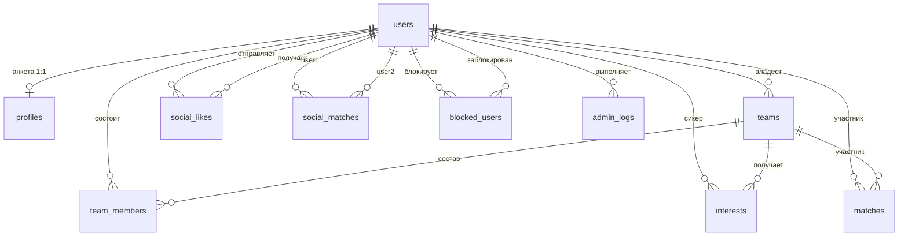

# База данных Connect (PostgreSQL 17). Ревизия 2

Статус: согласовано командой.
Любое изменение схемы = миграция Alembic + правка этого файла в том же PR.

## 1. Продуктовый контекст

Один FastAPI-бэкенд + одна PostgreSQL, модульный монолит. Режимы: Seeker (анкета + отклики),
Recruiter (команды + приглашения), Social (лайки по интересам), Admin (модерация + журнал).
Взаимный интерес → match → открываются контакты → вступление в команду только через
подтверждение владельца (candidate → member).

## 2. Конвенции именования и типов

- Таблицы: snake_case, множественное число; классы и файлы моделей: единственное.
- Колонки snake_case; внешний ключ `<сущность>_id`.
- PK: `id BIGINT GENERATED BY DEFAULT AS IDENTITY`.
- Время: только `TIMESTAMPTZ` (в ORM `DateTime(timezone=True)`), храним UTC.
- Перечисления: `VARCHAR(n)` + именованный `CHECK` (не PG ENUM).
- Индекс на каждую FK-колонку; составные индексы помним про левый префикс.
- Целостность (FK/UNIQUE/NOT NULL/CHECK) — в БД; бизнес-правила с подсчётами — в сервис-слое.

## 3. ER-диаграмма

## 4. Таблицы

### users
| Колонка | Тип | Ограничения |
|---|---|---|
| id | BIGINT | PK |
| tg_id | BIGINT | NOT NULL, UNIQUE |
| username | VARCHAR(64) | NULL |
| mode | VARCHAR(20) | NULL, CHECK IN ('seeker','recruiter','social') — предпочтительный режим, не роль |
| role | VARCHAR(20) | NOT NULL, DEFAULT 'user', CHECK IN ('user','moderator','admin') |
| is_banned | BOOLEAN | NOT NULL, DEFAULT FALSE |
| is_registered | BOOLEAN | NOT NULL, DEFAULT FALSE — завершён онбординг |
| created_at | TIMESTAMPTZ | NOT NULL, DEFAULT now() |

### profiles
| Колонка | Тип | Ограничения |
|---|---|---|
| id | BIGINT | PK |
| user_id | BIGINT | NOT NULL, UNIQUE, FK users CASCADE |
| bio | TEXT | NULL |
| full_name | VARCHAR(120) | NULL |
| course | INT | NULL |
| faculty | VARCHAR(120) | NULL |
| game | VARCHAR(64) | NULL — продуктовый фильтр |
| skill_level | VARCHAR(20) | NULL, CHECK IN ('beginner','middle','advanced','pro') |
| skills | JSONB | NOT NULL, DEFAULT '[]' |
| interests | JSONB | NOT NULL, DEFAULT '[]' |
| privacy | VARCHAR(20) | NOT NULL, DEFAULT 'public', CHECK IN ('public','friends_only','private') |
| contact | VARCHAR(128) | NULL — открывается только при активном мэтче |
| photo_file_id | VARCHAR(256) | NULL — Telegram file_id аватара |
| data_consent | BOOLEAN | NOT NULL, DEFAULT FALSE |
| updated_at | TIMESTAMPTZ | NOT NULL, DEFAULT now() |

Аватар отдаётся фронту **только через прокси-эндпоинт бэкенда** (`/api/users/{id}/photo`):
прямые Telegram file-URL содержат BOT_TOKEN и не должны попадать в клиент.

### teams
| Колонка | Тип | Ограничения |
|---|---|---|
| id | BIGINT | PK |
| name | VARCHAR(100) | NOT NULL |
| description | TEXT | NULL |
| owner_id | BIGINT | NOT NULL, FK users RESTRICT, индекс |
| max_members | INT | NULL — вместимость, NULL = без лимита |
| is_active | BOOLEAN | NOT NULL, DEFAULT TRUE |
| created_at | TIMESTAMPTZ | NOT NULL, DEFAULT now() |

### team_members
| Колонка | Тип | Ограничения |
|---|---|---|
| id | BIGINT | PK |
| user_id | BIGINT | NOT NULL, FK users CASCADE, индекс |
| team_id | BIGINT | NOT NULL, FK teams CASCADE, индекс |
| role | VARCHAR(20) | NOT NULL, DEFAULT 'member', CHECK IN ('owner','member','candidate') |
| joined_at | TIMESTAMPTZ | NOT NULL, DEFAULT now() |
| left_at | TIMESTAMPTZ | NULL — NULL = активное участие/заявка |

Partial UNIQUE `(user_id, team_id) WHERE left_at IS NULL`.
**Важно:** ORM-связь `team.members` возвращает ВСЮ историю, включая закрытые строки.
Активные участники фильтруются сервисом/репозиторием по `left_at IS NULL`;
бот и admin_ui обязаны использовать отфильтрованную выборку, иначе «вышедшие»
будут показаны как активные.

### interests
| Колонка | Тип | Ограничения |
|---|---|---|
| id | BIGINT | PK |
| user_id | BIGINT | NOT NULL, FK users CASCADE, индекс |
| team_id | BIGINT | NOT NULL, FK teams CASCADE, индекс |
| kind | VARCHAR(20) | NOT NULL, CHECK IN ('application','invitation') |
| created_by | BIGINT | NOT NULL, FK users CASCADE, индекс |
| created_at | TIMESTAMPTZ | NOT NULL, DEFAULT now() |

UNIQUE `(user_id, team_id, kind)`.

### matches
| Колонка | Тип | Ограничения |
|---|---|---|
| id | BIGINT | PK |
| user_id | BIGINT | NOT NULL, FK users CASCADE, индекс |
| team_id | BIGINT | NOT NULL, FK teams CASCADE, индекс |
| status | VARCHAR(20) | NOT NULL, DEFAULT 'active', CHECK IN ('active','closed') |
| matched_at | TIMESTAMPTZ | NOT NULL, DEFAULT now() |

UNIQUE `(user_id, team_id)`. Создаётся в одной транзакции со вторым взаимным interest.

### social_likes
| Колонка | Тип | Ограничения |
|---|---|---|
| id | BIGINT | PK |
| from_user_id | BIGINT | NOT NULL, FK users CASCADE, индекс |
| to_user_id | BIGINT | NOT NULL, FK users CASCADE, индекс |
| created_at | TIMESTAMPTZ | NOT NULL, DEFAULT now() |

UNIQUE `(from_user_id, to_user_id)`; CHECK `from_user_id <> to_user_id`.

### social_matches
| Колонка | Тип | Ограничения |
|---|---|---|
| id | BIGINT | PK |
| user1_id | BIGINT | NOT NULL, FK users CASCADE, индекс — меньший id |
| user2_id | BIGINT | NOT NULL, FK users CASCADE, индекс — больший id |
| status | VARCHAR(20) | NOT NULL, DEFAULT 'active', CHECK IN ('active','closed') |
| matched_at | TIMESTAMPTZ | NOT NULL, DEFAULT now() |

UNIQUE `(user1_id, user2_id)`; CHECK `user1_id < user2_id`.

### blocked_users
| Колонка | Тип | Ограничения |
|---|---|---|
| id | BIGINT | PK |
| user_id | BIGINT | NOT NULL, FK users CASCADE, индекс — кто блокирует |
| blocked_user_id | BIGINT | NOT NULL, FK users CASCADE, индекс — кого |
| created_at | TIMESTAMPTZ | NOT NULL, DEFAULT now() |

UNIQUE `(user_id, blocked_user_id)`; CHECK `user_id <> blocked_user_id`.

### admin_logs
| Колонка | Тип | Ограничения |
|---|---|---|
| id | BIGINT | PK |
| admin_id | BIGINT | NOT NULL, FK users RESTRICT, индекс |
| action | VARCHAR(50) | NOT NULL |
| target_type | VARCHAR(20) | NOT NULL, CHECK IN ('user','team','match','social_match','team_member') |
| target_id | BIGINT | NOT NULL — без FK: журнал переживает удаление целей |
| details | JSONB | NOT NULL, DEFAULT '{}' — snapshot на момент действия |
| created_at | TIMESTAMPTZ | NOT NULL, DEFAULT now() |

Индекс `(target_type, target_id)`.

## 5. Бизнес-правила

| № | Правило | Где |
|---|---|---|
| BR-1 | Не более `max_active_memberships` активных участий (конфиг, дефолт 10, None = выкл); активное = left_at IS NULL AND role IN ('owner','member'); проверка при подтверждении | конфиг + TeamService.approve_join |
| BR-2 | Одно активное участие/заявка на пару | partial UNIQUE в БД |
| BR-3 | Мэтч человек↔команда создаётся атомарно при application + invitation | сервис, одна транзакция |
| BR-4 | Соц-мэтч атомарно при взаимных лайках; пара нормализована | сервис, одна транзакция |
| BR-5 | Контакты только при активном мэтче | MatchService |
| BR-6 | «Вступить» только при активном мэтче → candidate; подтверждение владельцем → member (BR-1, BR-9); отклонение/кик/выход → left_at | TeamService |
| BR-7 | HR-выгрузки только при data_consent = TRUE | сервис аналитики |
| BR-8 | Забаненный не создаёт interests/likes/matches | сервис |
| BR-9 | При заданном max_members число активных участников не превышает его | TeamService.approve_join |
| BR-10 | Блокировка в любую сторону запрещает новые interests/social_likes/matches пары; при блокировке активные matches/social_matches пары закрываются; составы команд не меняются | BlockService |
| BR-11 | Создание interests/likes требует is_registered = TRUE | сервис |

## 6. Потоки

1. **Seeker:** онбординг (is_registered) → просмотр команд → application → приглашение владельца → match → контакты в TG → «вступить» → candidate → подтверждение → member.
2. **Recruiter:** создание teams (max_members) → invitation → отклик сикера → match → далее как в 1.
3. **Social:** social_like → взаимный → social_match → контакты.
4. **Admin:** действие модерации + admin_logs в той же транзакции.
5. **Блокировка:** blocked_users + закрытие активных мэтчей пары (BR-10).

## 7. Решения

- D-1. Модульный монолит, не микросервисы.
- D-2. Мэтч — сущность с жизненным циклом, не производная от лайков.
- D-3. Лимит команд — параметр конфига, не констрейнт схемы.
- D-4. Social-домен отдельными таблицами.
- D-5. admin_logs полиморфный, без FK на цель; snapshot в details.
- D-6. VARCHAR + CHECK вместо PG ENUM.
- D-7. data_consent с дефолтом FALSE.
- D-8. Источник истины — модели + миграции Alembic; док правится в том же PR.
- D-9. Двухшаговое вступление через candidate; trial отклонён (возврат = одна миграция).
- D-10. max_active_memberships в конфиге (дефолт 10).
- D-11. teams.max_members — вместимость команды.
- D-12. Аватар = Telegram file_id в profiles; отдача только через прокси бэкенда, никогда прямые file-URL с токеном.
- D-13. blocked_users отдельной таблицей + BR-10: блокировка рвёт мэтчи, но не составы команд.
- D-14. Поля ТЗ (full_name/course/faculty/skills/interests/is_registered/mode) реализованы в ревизии 2 согласно сверке ниже.

## 8. Сверка с ТЗ (ревизия 2, согласовано)

| ТЗ | Ревизия 2 | Обоснование |
|---|---|---|
| projects | teams | та же сущность «объявление набираемой команды»; имя приведено к домену продукта |
| invites | interests(kind='invitation') | объединено с откликами в одну таблицу взаимного интереса |
| user_settings | profiles.privacy/contact/data_consent | настройки живут в анкете, отдельная таблица не нужна |
| blocked_users | blocked_users | реализовано в ревизии 2 (BR-10) |
| users.mode | users.mode (nullable) | предпочтительный режим, не жёсткая роль |
| users.full_name/course/faculty | profiles.full_name/course/faculty | анкетные поля |
| users.skills/interests JSONB | profiles.skills/interests JSONB | без изменений по сути |
| users.is_registered | users.is_registered | флаг завершённого онбординга (BR-11) |

## 9. Политика изменений

Модели → `alembic revision --autogenerate` (env.py на sync-движке, URL из конфига с
`.replace("%", "%%")`) → ручная проверка миграции → `upgrade head` → правка этого дока
в том же PR. Смоук-тест стережёт список таблиц и таймзоны всех DateTime-колонок.
Round-trip тест миграций (upgrade→downgrade→upgrade) — следующий PR, владелец QA.
